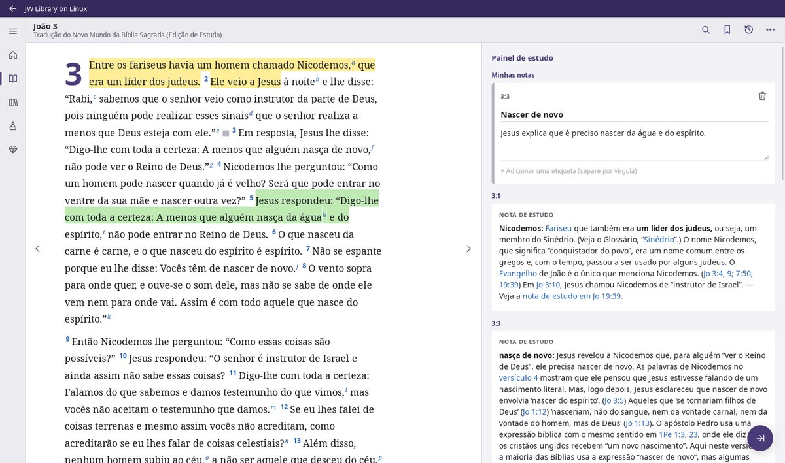
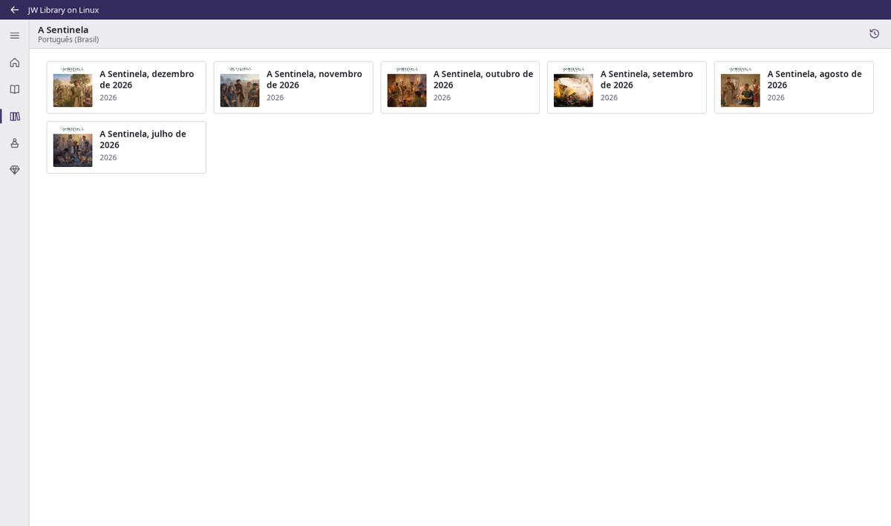
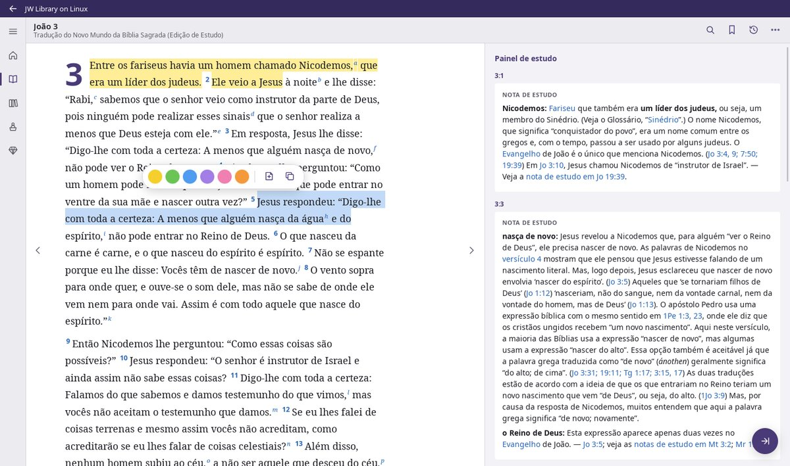
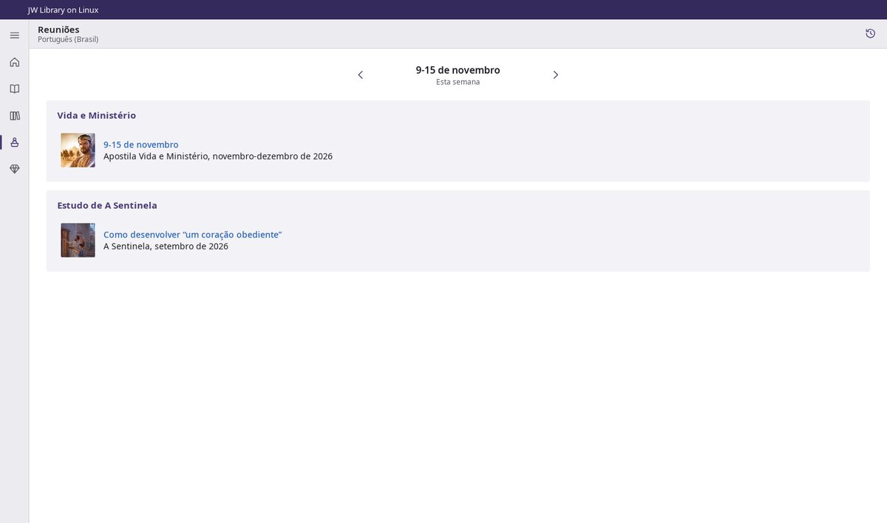
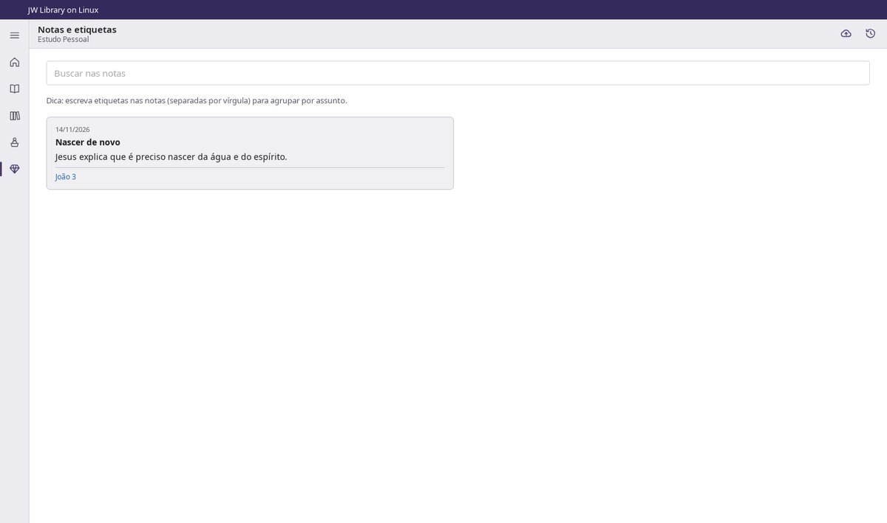
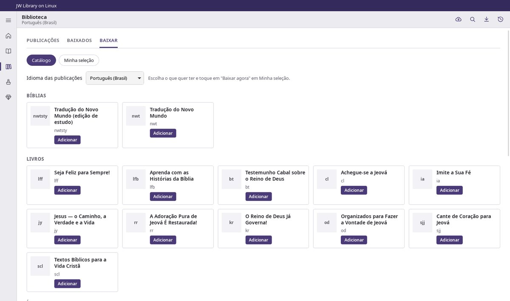
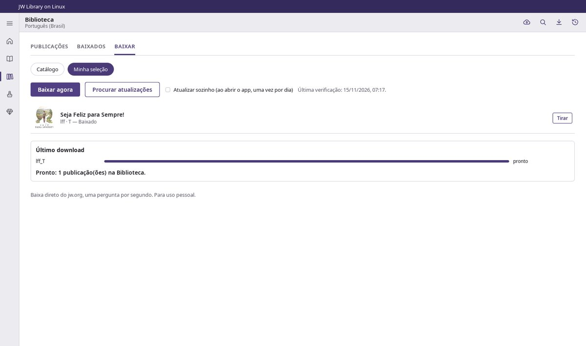
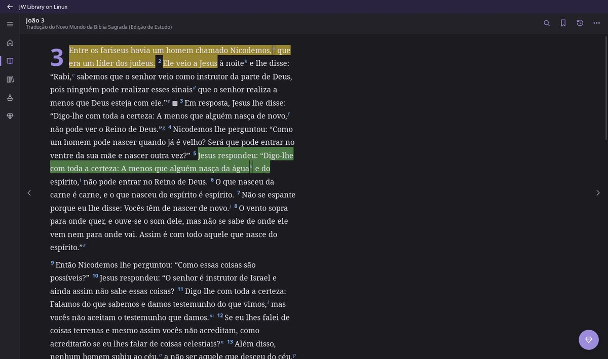
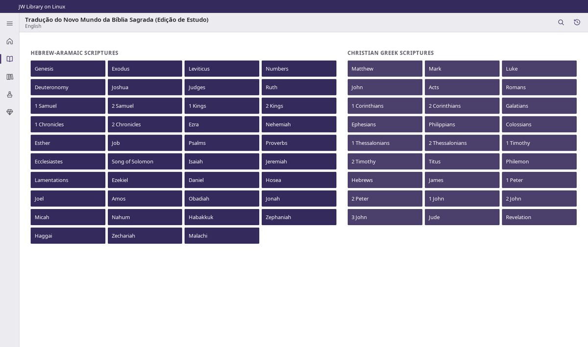

<p align="center"></p>

<p align="center">
  <a href="../../releases/latest"></a>
  
  
</p>

<p align="center"><b><a href="#english">English</a> · <a href="#português">Português</a></b></p>



| | |
|---|---|
|  |  |
|  |  |
|  |  |
|  |  |



---

## English

A `.jwpub` publication reader for Linux, in the style of JW Library for Windows.
It works offline with the `.jwpub` files you have: download them in the **Download** tab of the
Library, or import files you already have (from jw.org or copied from another device).

Community project with **no official connection** to the organization. The app ships no
publications and no JW Library CSS: publications are styled by its own CSS (`ui/estilo/`).
The interface is in **English** or **Brazilian Portuguese** (chosen on first launch and in Settings); it opens publications in any language.

| | |
|---|---|
|  |  |

### Features

- **Library** by category (Bibles, Books, The Watchtower, Meeting Workbooks…), years and issues, a
  Downloaded tab with sizes and sorting. Import `.jwpub` with the button, by dragging onto the window
  or from the notice about new files in your Downloads folder.
- **Reader** with a study panel (footnotes, quoted passages, Bible texts), article arrows, text size,
  full screen, light and dark themes.
- **Bible**: books, chapters, study notes, marginal references, verse menu and search.
- **Download** tab in the Library: pick publications and a language from a catalog, download them
  from jw.org straight into the Library, and get notified about new issues (The Watchtower, Meeting
  Workbook) and updated files. Formerly the separate "Downloader for JW Library on Linux".
- **Search** across all imported publications, and delete publications from the library.
- **Meetings**: the workbook and the Watchtower study of the week, with week arrows.
- **Personal Study**: highlights in 6 colors, notes with tags, bookmarks (10 ribbons), answer fields
  and a "Notes and tags" screen.
- **Backup** in the same `.jwlibrary` format as JW Library: move your highlights and notes to and
  from your phone.

### Install

Download from the [Releases](../../releases/latest) page:

- **Flatpak** (any distribution): `flatpak install --user JW_Library_on_Linux-0.5.0-x86_64.flatpak` (ARM: `-aarch64.flatpak`). Needs Flatpak with the Flathub remote.
- **AppImage**: make `JW_Library_on_Linux-0.5.0-x86_64.AppImage` (ARM: `-aarch64.AppImage`) executable and run it.

📖 **[Where to put your .jwpub files and how to import them](docs/PUBLICACOES.md#english)**

64-bit only (x86_64 or ARM64). Data lives in `~/.local/share/io.github.leitorjw/` (`biblioteca/` with the
publications and `userData.db` with highlights and notes, in JW Library's format).

### Build

```bash
cargo test -p leitor-nucleo
cargo run -p leitor-jw
cd app && cargo tauri build --bundles appimage
flatpak-builder --user --install --force-clean compilacao empacotar/flatpak/io.github.cruzthiago2010.JWLibraryOnLinux.yml
```

Requires `libwebkit2gtk-4.1-dev`, `librsvg2-dev`, `pkg-config` and `libssl-dev`.

### Disclaimer

This is an independent project made by volunteers, **not affiliated** with the Watch Tower Bible
and Tract Society or with JW Library. No publications are included: the Download tab fetches `.jwpub` files
from jw.org's public download service, one request per second, for personal use. Names mentioned belong to their owners. Screenshots show the app opening
publications for illustration only.

### License

GPL-3.0-or-later (see `LICENSE`).

---

## Português

Leitor de publicações `.jwpub` no estilo do JW Library do Windows, para quem usa Linux.
Funciona sem internet com os arquivos `.jwpub` que você tem: baixe na aba **Baixar** da Biblioteca
ou importe os arquivos que já tem (do jw.org ou copiados de outro aparelho).

Projeto da comunidade, **sem ligação oficial** com a organização. O app não traz publicações nem o
CSS do JW Library: o visual das publicações vem de um CSS próprio (`ui/estilo/`).
A interface fica em **português** ou **inglês**: o idioma é escolhido na primeira abertura e pode
ser trocado em Configurações. As publicações abrem em qualquer idioma.

### O que faz

- **Biblioteca** por categoria (Bíblias, Livros, A Sentinela, Apostilas…), anos e edições, aba Baixados
  com tamanho e ordenação. Importa `.jwpub` pelo botão, arrastando para a janela ou pelo aviso de
  arquivo novo na pasta Downloads.
- **Leitor** com painel de estudo (notas de rodapé, trechos citados, textos bíblicos), setas de artigo,
  tamanho do texto, tela inteira, tema claro/escuro.
- **Bíblia**: livros, capítulos, notas de estudo, referências marginais, menu do versículo e busca.
- Aba **Baixar** na Biblioteca: escolha publicações e idioma num catálogo, baixe do jw.org direto
  para a Biblioteca e receba aviso de edição nova (A Sentinela, Apostila) e de arquivo atualizado.
  Era o antigo "Baixador para JW Library on Linux", agora embutido.
- **Busca** em todas as publicações importadas, e excluir publicações da biblioteca.
- **Reuniões**: a apostila e o estudo de A Sentinela da semana, com setas de semana.
- **Estudo Pessoal**: grifos em 6 cores, notas com etiquetas, marcadores (10 fitas), campos de
  resposta, tela "Notas e etiquetas".
- **Backup** `.jwlibrary` no mesmo formato do JW Library: dá para levar grifos e notas para o
  celular ou trazer de lá.

### Instalar

- **Flatpak** (qualquer distribuição): `flatpak install --user JW_Library_on_Linux-0.5.0-x86_64.flatpak` (ARM: `-aarch64.flatpak`). Precisa do Flatpak com o Flathub configurado.
- **AppImage**: dê permissão de execução ao `JW_Library_on_Linux-0.5.0-x86_64.AppImage` (ARM: `-aarch64.AppImage`) e abra.

📖 **[Onde ficam os arquivos .jwpub e como importar](docs/PUBLICACOES.md#português)**

Os dados ficam em `~/.local/share/io.github.leitorjw/` (`biblioteca/` com as publicações e
`userData.db` com grifos e notas, no formato do JW Library).

### Pastas do código

- `baixar/` — a aba Baixar: API pública de download do jw.org, catálogo, seleção e registro.
- `nucleo/` — sem Tauri, testável: `.jwpub` (`jwpub.rs`), Biblioteca
  (`biblioteca.rs`), leitor (`leitor.rs`), painel (`estudo.rs`), Reuniões (`reunioes.rs`), Bíblia e
  busca (`biblia.rs`, `busca.rs`), estudo pessoal (`pessoal.rs` + `userdata.sql`, o esquema v16 do
  JW Library), tokens dos grifos (`tokens.rs`) e backup (`backup.rs`).
- `app/` — a casca Tauri 2 (comandos e o protocolo `conteudo://` das imagens).
- `ui/` — a janela (HTML/CSS/JS puro). `marcas.js` pinta os grifos com a API de destaques do CSS.
- `ferramentas/` — `gerar_css.py` (gera `ui/estilo/utilidades.css`) e `print.sh` (prints numa tela virtual).
- `docs/` — inventário das telas do JW Library usado como referência de desenho.

### Compilar

```bash
cargo test -p leitor-nucleo          # LEITOR_BIBLIOTECA=data/biblioteca LEITOR_BACKUP=<arquivo.jwlibrary> para testar com dados reais
cargo run -p leitor-jw
cd app && cargo tauri build --bundles appimage   # AppImage (precisa de ~3 GB livres)
flatpak-builder --user --install --force-clean compilacao empacotar/flatpak/io.github.cruzthiago2010.JWLibraryOnLinux.yml   # Flatpak
```

Precisa de `libwebkit2gtk-4.1-dev`, `librsvg2-dev`, `pkg-config` e `libssl-dev`.

### Aviso

Este é um projeto independente, feito por voluntários, **sem nenhuma ligação** com a Watch Tower
Bible and Tract Society nem com o JW Library. Nenhuma publicação acompanha o app: a aba Baixar busca os `.jwpub` no
serviço público de download do jw.org, uma pergunta por segundo, para uso pessoal. Os nomes citados pertencem aos seus donos.

### Licença

GPL-3.0-or-later (veja `LICENSE`).
